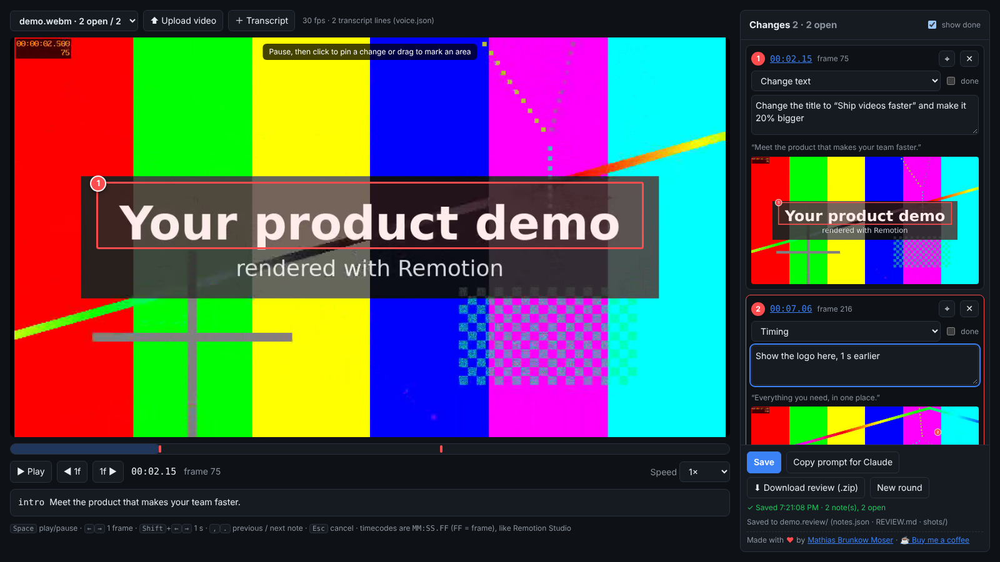
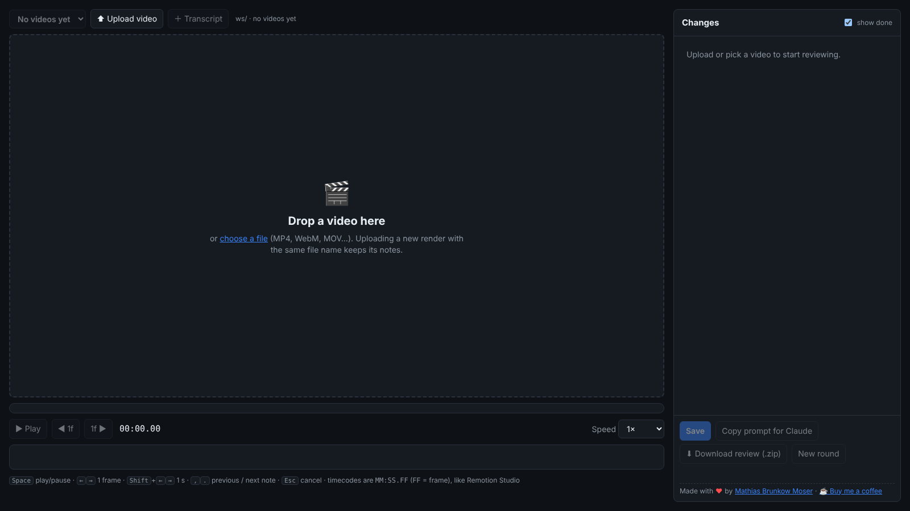

# AI Video Review Tool

**Point at the frame. Say what should change. Let Claude do the rest.**

Reviewing an AI-generated video usually means typing things like *"around 1:32, the box on the left, a bit
lower… no, the other one"* into a chat. This tool removes the guessing. You pause the video in your
browser, click (or drag a box) on the exact spot that should change and write what you want. Every note
is saved with the **exact frame**, the **position on the picture**, the **voice-over line spoken at that
moment** and a **screenshot with your mark drawn on it**, in a folder that Claude (or any other AI
agent) can read and implement.

It was built for videos made with [Remotion](https://www.remotion.dev) and Claude, but works with any
video your browser can play.



- **Upload or point at a folder**: drop a video onto the page, or start the tool in a folder of renders.
  Uploading a new render with the same file name keeps its notes, so you can check every fix.
- **Frame accurate**: step frame by frame; timecodes are `MM:SS.FF`, the same as Remotion Studio.
- **Pin or box**: click for a point, drag for an area. Marks are stored as fractions of the frame, so they
  are independent of the render resolution.
- **Knows what is being said**: load the voice-over or subtitles (`.json`, `.srt`, `.vtt`) and each note
  is linked to the line spoken at that moment, which is essential for audio changes.
- **Made for AI agents**: writes `notes.json` (exact values), `REVIEW.md` (instructions an agent can act
  on) and `shots/<id>.jpg` (what you saw). One click copies a ready-made prompt for Claude.
- **Review rounds**: mark notes as done, then start a new round; earlier rounds are kept in `rounds/`.
- **Re-mark and share**: move a note's pin or box without retyping it, and download the whole review as a
  `.zip` to attach it to Claude on claude.ai or send it to a teammate.
- **Touch friendly**: works with a mouse, a pen or a finger (review on a tablet).
- **Local and private**: a tiny Python server with **no dependencies**, listening on `localhost` only.
  Your video and notes never leave your machine.

## Quick start

Requirements: Python 3.9+ and a modern browser (Chrome, Edge, Safari or Firefox).

```bash
# install (from GitHub)
pip install "git+https://github.com/matbmoser/ai-video-review-tool.git"

# open the review page for the current folder, then drop a video onto it
video-review --open

# review one video
video-review out/video.mp4 --open

# with the voice-over / subtitles, at your render's frame rate
video-review out/video.mp4 --transcript voice/timeline.json --fps 30 --open

# review every video in a folder of renders
video-review out/ --open
```

No install? Clone the repo and run it straight from the source tree:

```bash
git clone https://github.com/matbmoser/ai-video-review-tool.git
PYTHONPATH=ai-video-review-tool/src python3 -m video_review out/video.mp4 --open
```

Then open <http://localhost:8765>, pick or upload a video, pause where something should change, **click**
(pin) or **drag** (box) on the picture and describe the change in the panel on the right. Notes save
automatically.



## Using it with Claude

The tool is the "eyes" half of a loop: Claude renders the video, you review it here, and Claude reads your
review and changes the code.

```text
 ┌────────────── Claude renders the video (Remotion, ffmpeg, …) ◀──────────────┐
 │                                                                              │
 ▼                                                                              │
 video-review out/video.mp4 ──▶ you pause, mark and describe changes            │
                                       │                                        │
                                       ▼                                        │
                     out/video.review/REVIEW.md · notes.json · shots/           │
                                       │                                        │
                                       ▼                                        │
       "Copy prompt for Claude" ──▶ Claude reads the review and implements it ──┘
```

1. **Render** a preview of your video (Claude can do this for you).
2. **Review**: run `video-review <video> --transcript <voice-over>` (or drop the video onto the page) and
   leave your notes.
3. **Hand over**: click **Copy prompt for Claude** and paste it into Claude Code (or any agent that can
   read files). The prompt points Claude at `REVIEW.md`, `notes.json` and the screenshots. Using Claude in
   the browser? Click **Download review (.zip)** and attach the zip together with the prompt.
4. **Check**: Claude answers per note number. Re-render (or upload the new render under the same name),
   reload the review page, tick **done** for every note that is fixed and add new notes where needed.
5. **Next round**: when a round is finished, click **New round**. The old notes move to `rounds/001/`, …

For the best results, install the included **Claude Code skill**. It teaches Claude how to read a review
folder, how to map marks to your code and how to report back:

```bash
mkdir -p .claude/skills && cp -r integrations/claude/skills/apply-video-review .claude/skills/
```

See **[docs/claude.md](docs/claude.md)** for the full workflow, the prompt, a `CLAUDE.md` snippet and
tips for Remotion projects.

## What gets saved

Every video gets a review folder next to it (`out/video.mp4` → `out/video.review/`). A transcript named
`video.transcript.json` (or `.srt` / `.vtt`, or `video.srt` / `video.vtt`) is picked up automatically:

```text
out/
├── video.mp4
├── video.transcript.json   # optional voice-over / subtitles (uploaded or copied here)
└── video.review/
    ├── notes.json          # source of truth: one entry per note (frame, mark, text, transcript line)
    ├── REVIEW.md           # the same notes as Markdown, with instructions for the AI agent
    ├── shots/              # the paused frame of every note, with the mark drawn on it
    │   ├── 1.jpg
    │   └── 2.jpg
    └── rounds/             # earlier review rounds ("New round")
        └── 001/
```

A real example is in [`examples/sample.review/`](examples/sample.review/REVIEW.md). The format is
documented in [docs/review-format.md](docs/review-format.md).

## Command line

```text
video-review [VIDEO | FOLDER] [options]      (default: the current folder)

  -t, --transcript FILE   voice-over / subtitles (.json, .srt, .vtt) for VIDEO, linked to each note
  -o, --review-dir DIR    where to save the review of VIDEO (default: <video name>.review next to it)
      --fps N             frame rate for frame stepping and timecodes (default: 30, match your render)
      --title TEXT        title shown in the browser tab
      --host ADDR         address to listen on (default: 127.0.0.1)
  -p, --port N            port (default: 8765; 0 picks a free one)
      --open              open the review page in your browser
      --no-upload         do not allow uploading videos or transcripts from the page
      --max-upload-mb N   largest video that can be uploaded (default: 20480 MB)
      --export-markdown   regenerate REVIEW.md of VIDEO from notes.json and exit
      --version
```

### Keyboard shortcuts

| Key | Action |
| --- | --- |
| <kbd>Space</kbd> | play / pause |
| <kbd>←</kbd> <kbd>→</kbd> | one frame back / forward |
| <kbd>Shift</kbd> + <kbd>←</kbd> <kbd>→</kbd> | one second back / forward |
| <kbd>,</kbd> <kbd>.</kbd> | jump to the previous / next note |
| <kbd>Esc</kbd> | cancel a mark or a re-mark, leave the text field |

More in **[docs/usage.md](docs/usage.md)**, including the transcript formats and troubleshooting.

## Documentation

| | |
| --- | --- |
| [docs/usage.md](docs/usage.md) | installing, running, reviewing, transcripts, troubleshooting |
| [docs/claude.md](docs/claude.md) | how it integrates with Claude: workflow, prompt, skill, `CLAUDE.md` snippet |
| [docs/review-format.md](docs/review-format.md) | `notes.json` / `REVIEW.md` reference for agents and scripts |
| [docs/architecture.md](docs/architecture.md) | how the tool is built, HTTP API, security model |
| [CONTRIBUTING.md](CONTRIBUTING.md) | development setup, tests, conventions |
| [SECURITY.md](SECURITY.md) | reporting vulnerabilities |

## Privacy and security

- The server binds to `127.0.0.1` and refuses requests with a foreign `Host` or `Origin` header, so other
  websites cannot read or change your review or upload files. Uploads are only written into the folder
  you started the tool in, with sanitised file names; `--no-upload` turns them off. `--host 0.0.0.0` exposes it to your network, so only use
  that on networks you trust.
- No telemetry, no accounts, no external requests: the page loads nothing from the internet.
- Your videos and review folders are ignored by this repository's `.gitignore`. Keep them out of
  public repos if they are confidential.

## Support

If this tool saves you time, you can [buy me a coffee with PayPal](https://paypal.me/mathiasbrunkowmoser). Thank you!

<a href="https://paypal.me/mathiasbrunkowmoser"></a>

## License

[MIT](LICENSE)

Made with ♥ by [Mathias Brunkow Moser](https://github.com/matbmoser).
